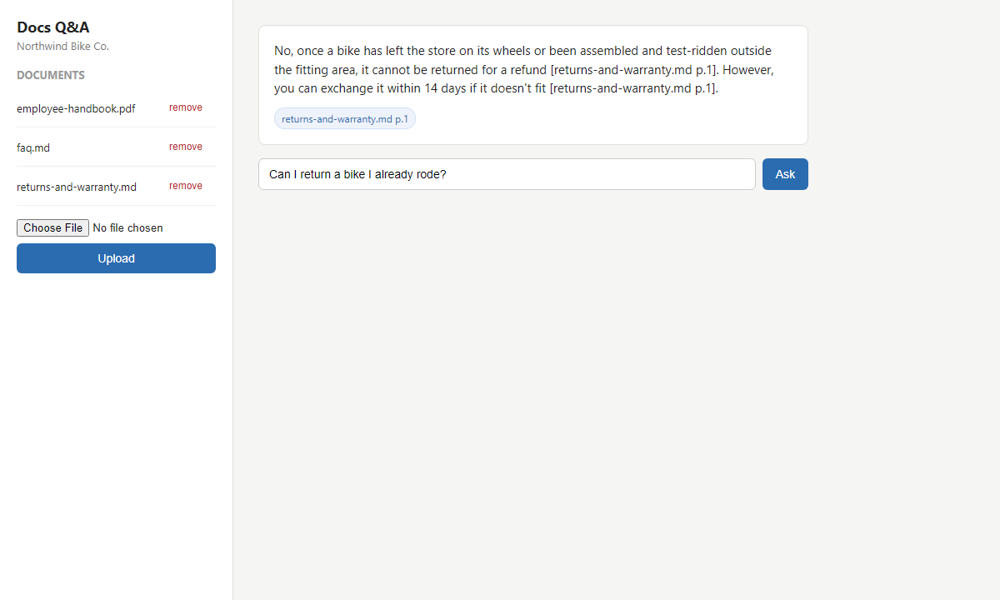

# Docs Q&A



A document Q&A assistant with citations. Upload PDFs, text, or markdown files
and ask questions about them; answers quote the source file and page inline,
and the app says so plainly when a question isn't covered by the documents
instead of guessing.

Built for a small business scenario: a team uploads a handbook, a policy doc,
and an FAQ, then asks questions instead of digging through files.

## What it does

- Upload PDF, .txt, or .md files, or start from the bundled sample docs
  (a fictional bike shop's handbook, warranty policy, and FAQ).
- Text is extracted per page, split into overlapping chunks that remember
  which file and page they came from.
- A question retrieves the most relevant chunks and the model answers only
  from them, citing every claim like `[handbook.pdf p.3]`.
- If the documents don't cover the question, it says "That isn't covered in
  the documents I have" instead of guessing.
- Chat page with a document panel (upload / remove) and clickable citation
  chips that show the source passage.

## Quick start

Needs Python 3.12.

### Windows

```
py -3.12 -m venv .venv
.venv\Scripts\activate
pip install -r requirements.txt
copy .env.example .env
uvicorn app.main:app --reload
```

### macOS / Linux

```
python3.12 -m venv .venv
source .venv/bin/activate
pip install -r requirements.txt
cp .env.example .env
uvicorn app.main:app --reload
```

Open http://localhost:8000. The bundled sample docs load automatically on
first run. Ask a question, or upload your own files from the sidebar.

With no `LLM_API_KEY` set, the app runs in demo mode: it returns the top
three matching passages with citations instead of a written answer, and
shows a banner saying so. It still runs end to end with zero config.

## Pointing it at a model

Set these in `.env`:

```
LLM_BASE_URL=https://api.openai.com/v1
LLM_API_KEY=sk-...
LLM_MODEL=gpt-4o-mini
EMBED_MODEL=text-embedding-3-small
```

For a local model through Ollama instead:

```
LLM_BASE_URL=http://localhost:11434/v1
LLM_API_KEY=ollama
LLM_MODEL=qwen2.5:14b-instruct
EMBED_MODEL=nomic-embed-text
```

Any OpenAI-compatible endpoint works the same way.

## How retrieval works

Chunks are embedded and compared to the question with cosine similarity,
kept in memory and cached to `data/` so a restart doesn't re-embed
everything. Without an API key, the app falls back to a pure-Python BM25
keyword search instead of embeddings. Either way, if the best-matching
chunk scores below a threshold the app skips the model entirely and returns
the "not covered" message, so the guardrail also lowers the number of LLM
calls, not just wrong answers.

## Running the tests

```
pytest
```

Tests run offline in demo mode: no API key or network calls needed.

## What I'd change for production

- Swap the in-memory numpy index for a real vector database once the
  document count grows past what fits comfortably in memory.
- Add authentication and per-team document sets instead of one shared index.
- Better PDF parsing for tables and scanned documents (OCR), since
  `pypdf` only pulls plain text.
- Collect feedback on answers (thumbs up/down) to catch bad retrievals and
  tune the guardrail threshold over time.

## License

MIT, see LICENSE.
